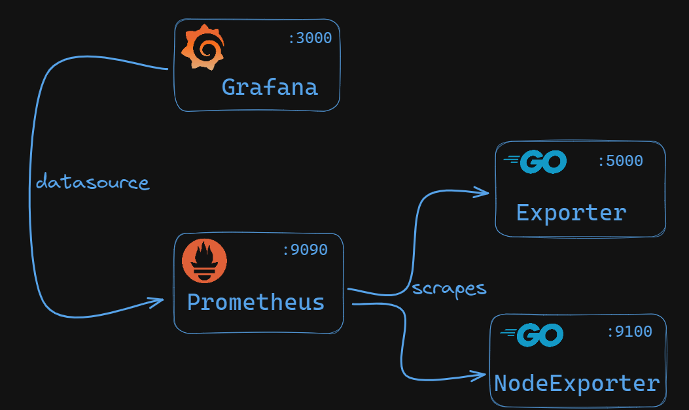
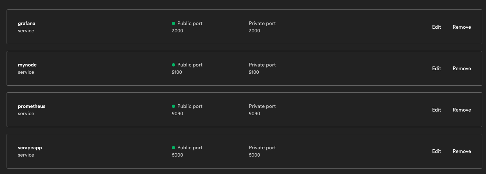

# monitoringStack
Monitoring stack comprised of Grafana/Prometheus/Golang



## Local setup

* Startup

```bash
# Spin up the exporter
# check promhttp_metric_handler_requests_total{code="200"} metric
docker run --rm -p 5000:5000 dejanualex/go_promexporter:1.0

# Spin up the stack
# check config
docker-compose -f docker-compose.yml config
# start in foreground
docker-compose -f docker-compose.yml up --remove-orphans
# stop services
docker-compose -f docker-compose.yml down
```
* Prometheus [available on 9090](http://127.0.0.1:9090/)
* Grafana [available on 3000](http://127.0.0.1:3000/login)
* [Go web-app/exporter](https://hub.docker.com/repository/docker/dejanualex/go_promexporter/general) [available on 5000](http://127.0.0.1:5000/)

    - Check `promhttp_metric_handler_requests_total` standard Prometheus Go client counter metric that tracks the total number of HTTP requests made to an application's `/metric`
    - Check series `promhttp_metric_handler_requests_total{instance="goexporter:5000"}` and `docker restart localgoexporter` to reset the counter

* Grafana [quick dashboard](https://grafana.com/grafana/dashboards/), check for Node Exporter Full

## Bunnyshell setup

